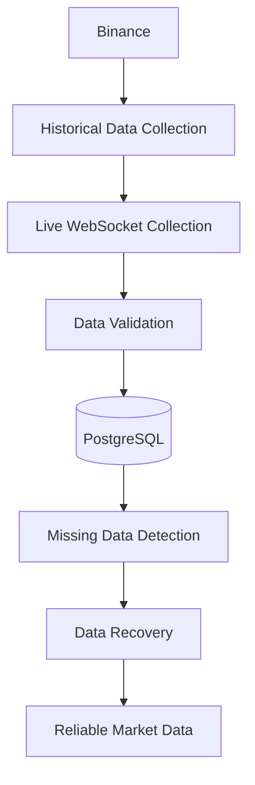
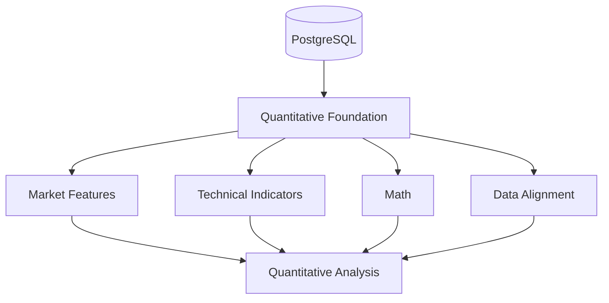

# Trafind

Trafind is a TypeScript market-data ingestion system for collecting and
repairing Binance cryptocurrency candles. It is a pnpm/Turborepo workspace
that stores raw OHLCV market data in PostgreSQL through Prisma and exposes an
Express API for health checks and market-data query validation.

The completed pipeline currently covers:

- Historical candle collection from Binance
- Closed-candle live WebSocket collection
- Candle mapping and validation
- PostgreSQL storage with duplicate protection
- Missing-candle detection and automatic repair
- Scheduled historical-data quality checks
- API request validation
- Market-features calculation
- Simple and exponential moving averages
- Relative Strength Index (RSI)
- Average True Range (ATR)
- MACD and its signal and histogram
- Historical volatility and percentage returns

The indicator modules are calculated from closed candle data in PostgreSQL.
Pattern discovery, hypothesis testing, and backtesting are described in
[docs/cycle.md](docs/cycle.md) but are not implemented yet.

## Project status

### Implemented

- Binance REST klines collection in batches of up to 1,000 candles
- REST request retries, retry filtering, and 10-second request timeouts
- Binance WebSocket collection for closed `SOLUSDT` 1-minute candles
- Conversion of Binance arrays and WebSocket messages into normalized candle
  objects
- Validation of prices, volume, OHLC relationships, dates, and closed status
- PostgreSQL persistence with a unique constraint for
  `(symbol, interval, openTime)`
- Historical, range, trailing-gap, and database-quality checks
- Automatic startup repair and a periodic repair scheduler
- Graceful worker shutdown for `SIGINT` and `SIGTERM`
- API health endpoint and market-candle query validation
- Candle price, range, wick, and volume features
- Percentage returns
- Simple Moving Average (SMA)
- Exponential Moving Average (EMA)
- Relative Strength Index (RSI)
- Average True Range (ATR)
- Moving Average Convergence Divergence (MACD)
- Population-standard-deviation historical volatility

### Current API and worker boundaries

- The market-candle endpoint validates input and echoes it; it does not yet
  query PostgreSQL.
- The worker's main entry point performs data repair. The Binance WebSocket
  client is implemented, but `connectBinanceWebSocket()` is not called by the
  main entry point.
- Live ingestion, recovery, and the repair scheduler are wired behind worker
  services and can be enabled or exercised separately.
- There is no configured end-to-end test runner yet. Source files under `tests`
  directories are manual TypeScript test scripts.

## Workspace

| Path | Purpose |
| --- | --- |
| `apps/api` | Express HTTP server, environment parsing, routes, middleware, and Zod validation |
| `apps/worker` | Binance REST/WebSocket clients, collectors, mappers, validators, quality checks, recovery, scheduling, and worker startup |
| `packages/database` | Prisma schema, PostgreSQL client, generated Prisma types, and candle repository |
| `docs/cycle.md` | Planned research pipeline from raw candles to trading strategies |

## Market Data Infrastructure



### Data flow

1. `getKlines()` requests a page of Binance REST klines.
2. `collectHistoricalKlines()` advances through the result pages using the
   last candle's open time.
3. `mapBinanceKline()` normalizes Binance values into a `MappedCandle`.
4. `validateCandle()` verifies OHLC, volume, price, and time constraints.
5. `saveMany()` inserts the validated candles and skips duplicates.
6. `checkDatabaseCandleQuality()` compares stored open times with the expected
   interval-aligned times and reports gaps.
7. `repairMissingCandles()` collects and resaves the affected range, then
   verifies that the gaps were repaired.

## Phase 2 — Quantitative Foundation



## Understanding the quantitative indicators

The quantitative foundation turns a list of candles into smaller numbers that
describe trend, momentum, price movement, and volatility. All calculations
use JavaScript numbers derived from Prisma decimal values. These indicators
help organize market behavior; they do not predict the future or guarantee a
profit.

### A candle in simple language

An OHLCV candle is a small market summary for one time period, such as one
minute.

| Term | Meaning |
| --- | --- |
| Open | The first traded price in the period |
| High | The highest traded price in the period |
| Low | The lowest traded price in the period |
| Close | The final traded price in the period |
| Volume | How much of the base asset was traded |

For example, a one-minute candle might open at 100, rise to 108, fall to 97,
and close at 105. It answers five questions: where did the period start,
which way did it move, how far did it go, where did it end, and how much was
traded?

### Market features

The market-feature module in
[apps/worker/src/quantative/market-features.ts](apps/worker/src/quantative/market-features.ts)
calculates a summary for one candle.

#### Price change

```text
price change = close - open
```

The sign tells the direction. A positive result means the candle closed above
where it opened; a negative result means it closed below. A result of 0 means
that the close and open were equal.

#### Percentage price change

```text
percentage price change = (close - open) / open * 100
```

This makes the change comparable between assets and prices. A change from 100
to 105 is +5%, while a change from 1,000 to 1,050 is also +5%, even though
the dollar amount is 10 times larger.

#### Candle range

```text
candle range = high - low
candle range percent = candle range / open * 100
```

The range is the distance between the highest and lowest prices during the
candle. The percent form is useful for comparing large and small-priced assets.

#### Candle body

```text
body size = absolute value of (close - open)
```

The body shows how far the candle moved from open to close. A long body means
the market moved strongly in one direction. A short body means the open and
close were close together.

#### Wicks

```text
upper wick = high - max(open, close)
lower wick = min(open, close) - low
```

Wicks show how far price moved beyond the candle body.

- The upper wick measures movement above the body's top.
- The lower wick measures movement below the body's bottom.
- Long wicks can show that buyers or sellers pushed price farther before the
  candle ended.

The implementation also validates the candle: prices must be finite and
positive, volume cannot be negative, the high must include both the open and
close, and the low must be below or equal to both.

### Percentage returns

The return module in
[apps/worker/src/quantative/returns.ts](apps/worker/src/quantative/returns.ts)
compares every closing price with the close immediately before it.

```text
return = (current close - previous close) / previous close * 100
```

For example, closes of 100 and 110 give:

```text
(110 - 100) / 100 * 100 = +10%
```

This is called a percentage return, not a raw price change. It answers how much
the position gained or lost relative to its previous value.

### Simple Moving Average (SMA)

The SMA module in
[apps/worker/src/quantative/moving-averages.ts](apps/worker/src/quantative/moving-averages.ts)
adds the closing prices inside a moving time window and divides by the window
length.

```text
SMA = sum of closing prices in the window / number of closing prices
```

For closes 10, 12, 14, 16, and 18 with a period of 3:

- First window: (10 + 12 + 14) / 3 = 12
- Next window: (12 + 14 + 16) / 3 = 14
- Final window: (14 + 16 + 18) / 3 = 16

Think of the window as a sliding box. Each candle moves the box forward and
drops the oldest candle. SMA is easy to understand, but every candle in the
window has the same weight. It can react slowly to sudden price changes.

### Exponential Moving Average (EMA)

An EMA is also an average, but newer prices count more than older prices.
It therefore reacts faster than an SMA.

The code starts by calculating the SMA of the first period. It then multiplies
the latest EMA by a smoothing factor and combines it with the new close:

```text
alpha = 2 / (period + 1)
new EMA = (new close * alpha) + (previous EMA * (1 - alpha))
```

The first EMA in this module is an SMA, and later values are updated one
candle at a time. A smaller period gives recent prices more influence and
produces a faster line. A larger period produces a slower, smoother line.

### Relative Strength Index (RSI)

RSI in
[apps/worker/src/quantative/rsi.ts](apps/worker/src/quantative/rsi.ts)
measures whether recent closing-price changes are mostly gains or mostly losses.
It converts that balance into a number from 0 to 100.

First the code subtracts each close from the next close:

```text
positive change -> gain
negative change -> loss
no change -> gain and loss are both zero
```

It then calculates average gains and average losses and uses:

```text
relative strength = average gain / average loss
RSI = 100 - 100 / (1 + relative strength)
```

Common interpretations:

| RSI range | Simple meaning |
| --- | --- |
| Above 70 | Gains have recently been much stronger; often described as overbought |
| 30 to 70 | Gains and losses are in a mixed or neutral range |
| Below 30 | Losses have recently been much stronger; often described as oversold |

These ranges are warnings or labels, not automatic buy or sell commands.
An upward market can remain above 70, and a downward market can remain below
30. The implementation smooths later averages by giving the previous average
more weight and introducing the next gain or loss gradually.

Special cases are handled safely:

- No gain and no loss -> RSI 50
- No losses, but gains exist -> RSI 100
- No gains, but losses exist -> RSI 0

### Average True Range (ATR)

ATR in [apps/worker/src/quantative/atr.ts](apps/worker/src/quantative/atr.ts)
measures how far price usually moves in one candle. It combines:

1. The current candle's high minus low.
2. The absolute difference between the current high and previous close.
3. The absolute difference between the current low and previous close.

```text
true range = largest of those three values
```

Using the previous close prevents the calculation from ignoring a gap that
opens outside the previous candle. The code averages the first `period` true
ranges, then smooths them.

```text
smoothed ATR =
(previous ATR * (period - 1) + current true range) / period
```

ATR is measured in the same units as price. An ATR of 2 on a 100-dollar asset
means the average candle movement is about 2 dollars. ATR does not say whether
price will rise or fall; it only describes recent movement size.

It is commonly useful for:

- Comparing how volatile two periods are
- Setting movement-based stop or position-size rules
- Showing that a quiet market became more active

### Moving Average Convergence Divergence (MACD)

MACD in [apps/worker/src/quantative/macd.ts](apps/worker/src/quantative/macd.ts)
compares a fast EMA with a slow EMA. The default values are 12, 26, and 9.

```text
MACD line = fast EMA - slow EMA
signal line = EMA of the MACD line
histogram = MACD line - signal line
```

The calculation works as follows:

1. Calculate the 12-period EMA of the closing prices.
2. Calculate the 26-period EMA.
3. Subtract the slow EMA from the fast EMA to form the MACD line.
4. Calculate a 9-period EMA of the MACD line to form the signal line.
5. Subtract the signal line from the MACD line to form the histogram.

Simple interpretations:

- MACD above zero: the fast trend is above the slow trend.
- MACD below zero: the fast trend is below the slow trend.
- MACD crosses above the signal line: short-term momentum is turning stronger.
- MACD crosses below the signal line: short-term momentum is weakening.
- A positive histogram: MACD is above its signal line.
- A negative histogram: MACD is below its signal line.

Fast EMAs are more sensitive, so MACD can change often. It is especially
likely to give false or late signals during sideways, noisy markets.

### Historical volatility

Historical volatility in
[apps/worker/src/quantative/volatility.ts](apps/worker/src/quantative/volatility.ts)
describes how spread out the return values were over the selected closing-price
series.

The basic statistical steps are:

1. Calculate each percentage return.
2. Calculate the average return.
3. Subtract the average from every return.
4. Square every difference.
5. Average the squared differences; this is variance.
6. Take the square root of variance; this is standard deviation.

```text
variance = average(squared difference from the mean)
volatility = square root(variance)
```

Squaring makes negative and positive differences equally important and gives
larger moves more weight. A small volatility means the returns were close to
their average. A large volatility means the returns were more spread out.

The module currently returns the population standard deviation of the provided
return series. It does not annualize the result and does not change the scale
for a 1-minute or 1-hour interval. Do not compare a raw 1-minute volatility
with a raw 1-hour volatility as if they used the same time base.

### How the indicators fit together

The indicators answer different kinds of questions:

| Indicator | Main question |
| --- | --- |
| Market features | What happened during this candle? |
| Returns | How much did price change from the previous close? |
| SMA | What is the simple average trend? |
| EMA | What is the recent-weighted trend? |
| RSI | Are recent gains or losses dominating? |
| ATR | How large are typical candle movements? |
| MACD | How strongly are fast and slow trends separating? |
| Volatility | How widely are percentage returns spread? |

No indicator should be used alone. A trend indicator can conflict with a
momentum indicator, and a momentum extreme does not prove that price will
reverse. Good analysis compares several indicators, the candle time frame,
market data quality, and a clearly defined risk rule.

## Roadmap

| Phase | Description | Status |
|---|---|---|
| 1 | Market Data Infrastructure | 🟢 Completed |
| 2 | Quantitative Foundation | 🟢 Completed |
| 3 | Backtesting Engine | Pending |
| 4 | Strategy Development | Pending |
| 5 | Risk Management | Pending |
| 6 | Paper Trading | Pending |
| 7 | Live Trading | Pending |

## Database model

Prisma stores market candles in the `candles` table.

| Field | Description |
| --- | --- |
| `id` | Auto-incrementing database identifier |
| `symbol` | Market symbol, for example `SOLUSDT` |
| `interval` | Prisma enum: `M1`, `M5`, or `H1` |
| `openTime` | UTC candle opening timestamp |
| `closeTime` | UTC candle closing timestamp |
| `open`, `high`, `low`, `close` | Decimal OHLC prices |
| `volume` | Base-asset volume |
| `quoteAssetVolume` | Quote-asset volume |
| `numberOfTrades` | Number of trades in the candle |
| `takerBuyBaseVolume` | Taker-buy base volume |
| `takerBuyQuoteVolume` | Taker-buy quote volume |
| `createdAt` | Database insertion timestamp |

The unique constraint prevents duplicate candles for the same symbol,
interval, and open time. `saveMany()` additionally uses Prisma's
`skipDuplicates` option for idempotent batch inserts.

Supported interval mappings:

| Binance | Database | Duration |
| --- | --- | --- |
| `1m` | `M1` | 60 seconds |
| `5m` | `M5` | 5 minutes |
| `1h` | `H1` | 60 minutes |

## Worker functions

### Worker entry point

[apps/worker/src/index.ts](apps/worker/src/index.ts) provides `startWorker()`
and process-signal handling:

- Verifies 30 days of `SOLUSDT` `1m` history at startup.
- Throws if missing candles remain after the initial repair attempt.
- Starts a repair cycle every five minutes.
- Checks and repairs the latest 24 hours of data in each scheduled cycle.
- Stops the scheduler and disconnects Prisma when `SIGINT` or `SIGTERM` is
  received.

### Binance REST client

`getKlines()` in
[apps/worker/src/clients/binance.client.ts](apps/worker/src/clients/binance.client.ts):

- Calls Binance's public market-data endpoint.
- Builds symbol, interval, limit, start time, and end time query parameters.
- Defaults to a page limit of 1,000 candles.
- Uses a 10-second request timeout.
- Retries temporary failures up to two times.
- Retries HTTP 429 and 5xx responses, but does not retry other HTTP errors.
- Throws a typed `BinanceApiError` for a non-successful HTTP response.
- Rejects non-array Binance payloads.

### Historical collector

`collectHistoricalKlines()` in
[apps/worker/src/collectors/historical-data.collector.ts](apps/worker/src/collectors/historical-data.collector.ts):

- Uses an async generator to return one REST page at a time.
- Requests pages beginning after the current cursor.
- Stops at the requested end time or after an empty/short page.
- Advances based on the final candle open time and interval duration.
- Throws if Binance does not advance the collection cursor.

### Candle mappers

`mapBinanceKline()` in
[apps/worker/src/mappers/binance.mapper.ts](apps/worker/src/mappers/binance.mapper.ts)
converts a Binance REST array and symbol/interval metadata into a
`MappedCandle`.

`mapWebSocketMessageToKline()` in
[apps/worker/src/mappers/binance-websocket.mapper.ts](apps/worker/src/mappers/binance-websocket.mapper.ts)
converts a Binance WebSocket kline payload into the same array shape used by
the REST mapper.

### Candle validator

`validateCandle()` in
[apps/worker/src/validators/candle.validator.ts](apps/worker/src/validators/candle.validator.ts)
rejects candles with:

- Missing or non-finite numeric values
- Non-positive open, high, low, or close prices
- Negative volume
- A high price below the open or close
- A low price above the open or close
- A high price below the low
- A close time earlier than the open time

`isCandleClosed()` returns whether a candle's close time has already passed.

### Historical data service

`collectAndSaveHistoricalData()` in
[apps/worker/src/services/historical-data.service.ts](apps/worker/src/services/historical-data.service.ts):

- Finds the latest database candle for the requested symbol and interval.
- Resumes after that candle by default.
- Supports `resumeFromLatest: false` for forced range collection and repair.
- Maps, validates, and filters closed historical candles.
- Converts Binance interval names to Prisma interval names.
- Saves batches and reports received, valid, saved, and skipped totals.

### Live candle service

`processLiveCandle()` in
[apps/worker/src/services/live-candle.service.ts](apps/worker/src/services/live-candle.service.ts):

- Ignores non-final WebSocket updates.
- Maps a closed WebSocket kline and validates it.
- Converts the interval to the database enum.
- Saves through `retry()` with two retries and linear 1-second, 2-second
  delays.
- Logs the saved result and key candle information.

### WebSocket client

`connectBinanceWebSocket()` in
[apps/worker/src/clients/binance-websocket.client.ts](apps/worker/src/clients/binance-websocket.client.ts):

- Connects to the `SOLUSDT@kline_1m` Binance WebSocket stream.
- Runs data recovery after each connection opens.
- Buffers closed messages while recovery is running.
- Processes the buffered messages only after recovery completes.
- Sends a WebSocket ping every 30 seconds and terminates unresponsive peers.
- Reconnects with exponential backoff from 1 second to 30 seconds.
- Prevents outdated connection attempts and recovery tasks from affecting a
  newer connection.
- Provides `close()` for clearing timers and shutting down the socket.

### Data quality functions

[apps/worker/src/services/data-quality.service.ts](apps/worker/src/services/data-quality.service.ts)
provides:

- `detectMissingCandles(openTimes, intervalDuration)` — finds gaps between
  adjacent sorted candle open times.
- `areCandleTimesSorted(openTimes)` — rejects duplicate or descending times.
- `areCandleDatesValid(openTimes)` — verifies that every date is real and
  finite.
- `checkCandleData(openTimes, intervalDuration)` — validates date shape and
  sorting, then reports internal gaps.
- `checkDatabaseCandleQuality(params)` — loads open times from PostgreSQL and
  compares the full requested range with interval-aligned expected times.
- `detectTrailingMissingCandles(latestOpenTime, intervalDuration, now)` —
  finds missing closed candles after the latest stored open time.
- `detectMissingCandlesInRange(openTimes, startTime, endTime, duration)` —
  checks an exact aligned time range, excluding the current open candle.

### Quantitative services

The worker package provides database-facing functions that fetch closed candles
and return the latest indicator values:

- `getLatestMarketFeatures(symbol, interval, limit)` loads recent candles and
  returns OHLC, percentage, range, body, wick, and volume features.
- `getMovingAverages(symbol, interval, periods)` loads enough candles for the
  requested periods and returns the latest SMA and EMA for each period.
- `getHistoricalVolatility(symbol, interval, limit)` loads recent candles,
  calculates percentage returns, and returns their population standard
  deviation.
- `getATR(symbol, interval, period)` loads `period + 1` candles and returns
  the latest smoothed ATR value.
- `getMACD(symbol, interval, fastPeriod, slowPeriod, signalPeriod)` loads
  enough candles for the default or custom periods and returns the latest
  MACD line, signal line, and histogram.

The underlying formulas live in
`apps/worker/src/quantative/` and are separate from Prisma queries. This makes
the formulas reusable and easier to test. The services map `1m`, `5m`, and
`1h` to the database's `M1`, `M5`, and `H1` interval names.

Manual indicator checks are available in
`apps/worker/src/services/tests/` for market features, moving averages,
volatility, ATR, and MACD.

### Recovery and repair functions

`recoverMissingCandles()` in
[apps/worker/src/services/data-recovery.service.ts](apps/worker/src/services/data-recovery.service.ts)
finds the latest candle in the database and collects from the next expected
open time through the present.

`repairMissingCandles()` in
[apps/worker/src/services/data-repair.service.ts](apps/worker/src/services/data-repair.service.ts)
performs a more complete repair:

1. Runs a database-quality check.
2. Collects the first-to-last affected historical range.
3. Forces collection instead of starting from the latest candle.
4. Runs the quality check again.
5. Returns repaired and remaining-candle counts.

### Scheduler and retry helpers

`startDataRepairScheduler()` in
[apps/worker/src/schedulers/data-repair.scheduler.ts](apps/worker/src/schedulers/data-repair.scheduler.ts):

- Runs an immediate first cycle.
- Repeats at the configured interval.
- Skips a cycle if the previous repair is still running.
- Catches and logs cycle failures without stopping future cycles.
- Stops the timer and waits for active work during shutdown.

`retry()` in [apps/worker/src/utils/retry.ts](apps/worker/src/utils/retry.ts)
runs an async operation repeatedly. Each failure waits longer than the previous
failure: `delay * (attempt + 1)`. An optional `shouldRetry(error)` predicate
decides whether an attempt is worth retrying; the final attempt's error is
always rethrown.

## Database package functions

### Prisma client

[packages/database/src/client.ts](packages/database/src/client.ts) creates a
Prisma PostgreSQL client using `@prisma/adapter-pg`. It requires
`DATABASE_URL` and sets the PostgreSQL timezone to UTC.

### Candle repository

[packages/database/src/repositories/candle.repository.ts](packages/database/src/repositories/candle.repository.ts)
provides:

- `saveMany(candles)` — inserts a batch while skipping duplicate rows.
- `findLatest(symbol, interval)` — returns the newest stored candle.
- `findCandleOpenTimes(symbol, interval, startTime, endTime)` — returns
  ascending open times for a database-quality check.

The package exports these functions and `prisma` through
[packages/database/src/index.ts](packages/database/src/index.ts).

## API functions and endpoints

### API health

`GET /api/health`

Returns:

- Service status
- A fixed success message
- An ISO-8601 timestamp

### Market candle validation

`GET /api/market/candles`

Example:

```text
GET /api/market/candles?symbol=SOLUSDT&interval=1h&limit=100
```

`candlesQuerySchema` in
[apps/api/src/schemas/validation-schema.ts](apps/api/src/schemas/validation-schema.ts)
validates and defaults:

- `symbol`: exactly `SOLUSDT`
- `interval`: `1m`, `5m`, or `1h`; defaults to `1h`
- `limit`: integer from 1 to 1000; coerced from the query string; defaults to
  100

`getCandles()` validates the request and returns the selected values. Invalid
input returns HTTP 400 with Zod issue details. This endpoint does not read
candles from PostgreSQL yet.

The API also includes:

- `notFoundHandler()` — returns HTTP 404 for unmatched routes.
- `errorHandler()` — logs unexpected errors and returns HTTP 500.
- Environment validation — validates `PORT` and `NODE_ENV`; the default port
  is `4000`.

## Requirements

- Node.js 20 or newer
- pnpm 12
- PostgreSQL 15 or newer

## Getting started

1. Install workspace dependencies:

   ```sh
   pnpm install
   ```

2. Create the database environment file:

   ```sh
   cp packages/database/.env.example packages/database/.env
   ```

   On Windows PowerShell, use:

   ```powershell
   Copy-Item packages/database/.env.example packages/database/.env
   ```

   Set `DATABASE_URL` to the PostgreSQL connection string.

3. Generate Prisma and apply migrations:

   ```sh
   pnpm --filter @trafind/database generate
   pnpm --filter @trafind/database migrate:dev
   ```

4. Start the API:

   ```sh
   pnpm --filter @trafind/api dev
   ```

5. Start the worker:

   ```sh
   pnpm --filter @trafind/worker dev
   ```

The API reads `PORT` and defaults to `4000`. The database process reads
`DATABASE_URL` from `packages/database/.env`.

## Development commands

```sh
# Build a package
pnpm --filter @trafind/database build
pnpm --filter @trafind/worker build
pnpm --filter @trafind/api build

# Generate Prisma
pnpm --filter @trafind/database generate

# Apply development migrations
pnpm --filter @trafind/database migrate:dev

# Run package development servers
pnpm --filter @trafind/api dev
pnpm --filter @trafind/worker dev

# Run built output
pnpm --filter @trafind/api start
pnpm --filter @trafind/worker start
```

Build ordering can also be coordinated with Turbo:

```sh
pnpm exec turbo build
pnpm exec turbo dev
```

## Manual worker tests

The worker contains manual scripts under `apps/worker/src/clients/tests`,
`apps/worker/src/services/tests`, and `apps/worker/src/utils/tests`. They cover
BINANCE REST/collector behavior, database and range quality, repair/recovery,
WebSocket behavior, retry behavior, and the market features, moving averages,
historical volatility, ATR, and MACD indicators. They are TypeScript files
intended for direct execution or future test-runner integration; they are not
exposed as workspace test scripts and should not be treated as an automated
suite.
